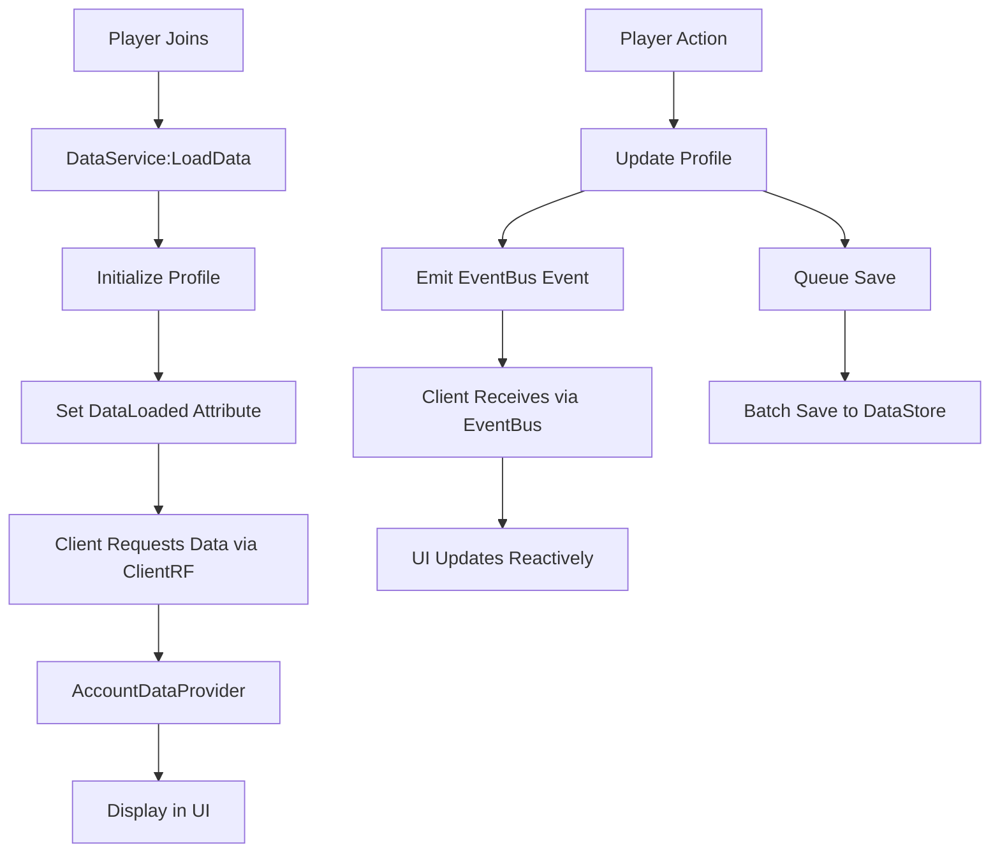

# Account & Profile System Documentation

## Overview

The Account & Profile system manages player data persistence, session tracking, and profile information display. It provides a robust framework for storing player progress, preferences, and statistics across game sessions.

## Architecture

### Core Components

```
server/MiningGame/
├── DataService.lua           # Main data persistence layer (emits EventBus events)
├── SessionService.lua        # Session tracking and playtime
├── ServiceContainer.lua      # Dependency injection container
└── RemoteFns/
    └── Core.rf.lua          # GetProfile RF spec

client/MiningGame/
├── Data/
│   └── AccountDataProvider.lua   # Reactive data management (EventBus subscriber)
├── RemoteEventBridge.client.lua  # EventBus bridge for events
└── UI/
    ├── ClientUI.client.lua   # Initializes data providers
    └── Components/
        └── AccountTab.lua    # Real-time account display
```

Note: The GetProfile RF spec currently lives in `server/MiningGame/RemoteFns/Dig.rf.lua`.

## Data Flow



## DataService

The core service managing all player data persistence.

### Data Structure

```lua
PlayerProfile = {
    -- Currency
    coins = 0,
    gems = 0,
    
    -- Statistics
    totalBlocksDug = 0,
    playtime = 0,           -- Lifetime seconds played
    sessionStartTime = nil, -- Injected at runtime (not persisted)
    lastSaveTime = os.time(),
    
    -- Metrics Tracking (Added for comprehensive metrics system)
    totalCoinsEarned = 0,   -- Lifetime coins earned
    totalCoinsSpent = 0,    -- Lifetime coins spent
    totalGemsEarned = 0,    -- Lifetime gems earned
    totalGemsSpent = 0,     -- Lifetime gems spent
    totalSessions = 0,      -- Number of sessions played
    lastLoginTime = os.time(), -- Last login timestamp
    sessionStartBlocks = 0, -- Blocks at session start (baseline)
    
    -- Progression
    materialId = "tier1",   -- Current cube material
    cubeSeed = 0,           -- Unique cube generation seed
    
    -- Inventory
    inventory = {
        itemId = count,
        -- ...
    },
    
    -- Settings & Preferences
    materialPreferences = {
        palette = "default",
        cubeMaterial = "rock", 
        floorMaterial = "concrete"
    },
    
    -- Upgrade System
    upgrades = {
        luck = { level = 0 },
        size = { level = 0 },
        speed = { level = 0 }
    },
    
    -- Pets
    pets = {},
    activePetSlots = {}

CubeState = {
    dugCells = {},  -- Array of dug cell positions
    materialId = "tier1"
}
```

### Key Methods

#### Loading Data
```lua
function DataService:LoadData(player: Player)
    -- Loads from DataStore with retry logic
    -- Creates default profile if new player
    -- Sets DataLoaded attribute when complete
end

-- Usage: Automatically called on PlayerAdded
```

#### Getting Data
```lua
-- Get player profile
local profile = DataService:GetPlayerData(player)

-- Get cube state
local cubeState = DataService:GetCubeData(player)

-- Get material preferences
local prefs = DataService:GetMaterialPrefs(player)

-- Ensure data is loaded (returns false if failed)
local success = DataService:EnsureLoaded(player)
```

#### Updating Data
```lua
-- Update currency (emits CURRENCY_CHANGED event)
DataService:AddCurrency(player, "coins", 100)
-- Automatically emits:
-- EventBus:emit(EventNames.CURRENCY_CHANGED, {
--     to = {kind = "player", player = player},
--     payload = {currency = "coins", balance = newBalance, delta = 100}
-- })

-- Update statistics
profile.totalBlocksDug = profile.totalBlocksDug + 1

-- Add playtime
DataService:AddPlaytime(player, sessionDuration)

-- Update preferences
DataService:UpdateMaterialPrefs(player, {
    palette = "desert",
    cubeMaterial = "sand"
})

-- Queue save (batched for efficiency)
DataService:QueueSave(player)
```

### Save System

DataService uses a queued save system to optimize DataStore usage:

1. Changes are made to in-memory profile
2. `QueueSave(player)` marks player for saving
3. Every 30 seconds, all queued saves are batched
4. On player leave, immediate save is forced

```lua
-- Manual save (avoid using directly)
DataService:SavePlayerData(player)

-- Queue for batch save (preferred)
DataService:QueueSave(player)
```

## SessionService

Tracks player session times and updates lifetime playtime. Also tracks session baselines for metrics.

### API

```lua
-- Get session start time
local startTime = SessionService.getSessionStartTime(userId)

-- Get current session duration
local elapsed = SessionService.getSessionElapsed(userId)
```

### Integration with DataService

```lua
-- On PlayerAdded (sets baseline metrics)
profile.totalSessions = (profile.totalSessions or 0) + 1
profile.lastLoginTime = os.time()
profile.sessionStartBlocks = profile.totalBlocksDug or 0

-- On PlayerRemoving
local sessionDuration = os.time() - sessionStartTime
DataService:AddPlaytime(player, sessionDuration)
```

### Profile Access via RFRegistry

```lua
-- In RemoteFns/Dig.rf.lua
{
    name = "GetProfile",
    validate = SchemaValidators.None,
    rateLimitSec = 1,
    requireProfile = true, -- Ensures profile is loaded
    handler = function(ctx)
        local profile = ctx.profile -- Automatically provided
        local SessionService = getService("SessionService")
        
        -- Inject session time
        profile.sessionStartTime = SessionService.getSessionStartTime(ctx.player.UserId)
        
        return Result.ok({
            profile = profile,
            effectiveStats = effectiveStats,
            -- ...
        })
    end
}
```

## AccountDataProvider (Client)

Reactive client-side data management with EventBus integration for automatic synchronization.

### Modern Reactive API with EventBus

```lua
local AccountDataProvider = require(MiningGame.Data.AccountDataProvider)
local EventBus = require(MiningGame.EventBus).global()
local EventNames = require(MiningGame.EventNames)

-- Provider automatically subscribes to EventBus events
local provider = AccountDataProvider.new()

-- Get current snapshot
local snapshot = provider:getSnapshot()
-- snapshot = {
--     profile = { coins, gems, playtime, sessionStartTime, ... },
--     cubeStats = { dugCells, ... },
--     lastUpdated = timestamp,
--     isLoading = false
-- }

-- Subscribe to changes (fired by EventBus events)
local connection = provider:onChanged():Connect(function(key, value, snapshot)
    if key == "coins" then
        print("Coins updated:", value)
    end
    -- React to any data change
end)

-- Request data refresh via ClientRF
provider:refresh()

-- Cleanup (also unsubscribes from EventBus)
provider:destroy()
```

### Data Flow with EventBus
1. Provider fetches initial profile via ClientRF.call("GetProfile")
2. Stores data in snapshot with timestamp
3. Subscribes to EventBus events:
   - `PROFILE_UPDATED` - Full profile refresh
   - `CURRENCY_CHANGED` - Currency updates
   - `INVENTORY_CHANGED` - Inventory modifications
   - `UPGRADES_CHANGED` - Upgrade purchases
   - `BOOSTS_CHANGED` - Active boosts
4. EventBus events trigger onChanged callbacks
5. UI components react to changes automatically

### AccountTab Integration

The AccountTab component uses reactive data for real-time updates:

```lua
function AccountTab.new(props)
    local self = setmetatable({}, AccountTab)
    self._dataProvider = props.dataProvider
    
    -- Subscribe to data changes
    if self._dataProvider then
        local conn = self._dataProvider:onChanged():Connect(function(_, _, snap)
            self:_applySnapshot(snap)
        end)
        table.insert(self._connections, conn)
    end
    
    -- Update playtime every second
    task.spawn(function()
        while self._playtimeTick do
            self:_updatePlaytime()
            task.wait(1)
        end
    end)
    
    return self
end

function AccountTab:_applySnapshot(snapshot)
    local profile = snapshot.profile or {}
    
    -- Update displays
    if self._labels.coins then
        self._labels.coins.Text = UIUtils.formatNumber(profile.coins or 0)
    end
    
    if self._labels.blocksDug then
        self._labels.blocksDug.Text = UIUtils.formatNumber(profile.totalBlocksDug or 0)
    end
    
    -- Update session tracking
    self._joinTime = snapshot.sessionStartTime or self._joinTime
    self._baseLifetimeSeconds = profile.playtime or 0
    self:_updatePlaytime()
end

function AccountTab:_updatePlaytime()
    local sessionElapsed = os.time() - self._joinTime
    local totalPlaytime = self._baseLifetimeSeconds + sessionElapsed
    
    self._labels.playTime.Text = self:_formatDuration(sessionElapsed)
    self._labels.lifetime.Text = self:_formatDuration(totalPlaytime)
end
```

## Data Loading Flow

### Server-Side Initialization

1. **Player Joins** → `DataService:LoadData(player)`
2. **Load from DataStore** → With retry logic
3. **Apply Backfills** → Update old save formats
4. **Set DataLoaded** → `player:SetAttribute("DataLoaded", true)`
5. **Initialize Cube** → `DigService:InitializePlayerCube(player)`

### Client-Side Initialization

1. **ClientUI Bootstrap** → Create AccountDataProvider
2. **Wait for DataLoaded** → Monitor attribute
3. **Request Profile** → `ClientRF.call("GetProfile")`
4. **Provider Stores Data** → Updates snapshot
5. **Subscribe to EventBus** → Listen for server events
6. **Fire onChanged** → Notify subscribers
7. **UI Components React** → Update displays

```lua
-- In ClientUI.client.lua
local accountDataProvider = AccountDataProvider.new()

-- Provider automatically subscribes to EventBus events:
-- PROFILE_UPDATED, CURRENCY_CHANGED, INVENTORY_CHANGED, etc.

-- Create settings with provider injection
local settingsPanel = SettingsPanel.new({ 
    accountDataProvider = accountDataProvider 
})

-- Subscribe to updates (triggered by EventBus)
accountDataProvider:onChanged():Connect(function(key, value, snapshot)
    if snapshot and snapshot.profile then
        hud:SetCurrencies(snapshot.profile.coins or 0, snapshot.profile.gems or 0)
    end
end)
```

## Material Preferences System

### Saving Preferences

```lua
-- Server-side save
DataService:UpdateMaterialPrefs(player, {
    palette = "desert",
    cubeMaterial = "sand",
    floorMaterial = "sandstone"
})

-- Client-side request
Remotes.RF.SetPalettePreference:InvokeServer("desert")
Remotes.RF.ApplyCubeSurfaceMaterial:InvokeServer("sand")
Remotes.RF.ApplyFloorMaterial:InvokeServer("sandstone")
```

### Loading Preferences

```lua
-- Server-side on cube spawn (DigService)
local materialPrefs = DataService:GetMaterialPrefs(player)
if materialPrefs then
    -- Apply floor material
    local floorMaterial = MaterialKeys.EnumFromKey[materialPrefs.floorMaterial]
    GridService:RestoreCube(origin, cubeState, floorMaterial)
    
    -- Apply cube material
    if materialPrefs.cubeMaterial then
        CubeMaterialService.ApplyCubeSurfaceMaterial(player, materialPrefs.cubeMaterial)
    end
end

-- Client-side palette loading (AmbientBoot)
if not player:GetAttribute("DataLoaded") then
    player:GetAttributeChangedSignal("DataLoaded"):Wait()
end
local prefs = Remotes.RF.GetMaterialPreferences:InvokeServer()
if prefs and prefs.palette then
    MaterialManager.SetPalette(prefs.palette)
end
```

## Best Practices

### 1. Use Reactive Data Providers

```lua
-- Good: Reactive subscription
Provider:onChanged():Connect(function(key, value, snapshot)
    updateUI(snapshot)
end)

-- Avoid: Polling
while true do
    local data = fetchData()  -- Don't do this
    updateUI(data)
    task.wait(1)
end
```

### 2. Always Check DataLoaded

```lua
-- Server
if not DataService:EnsureLoaded(player) then
    return {ok = false, reason = "Data not loaded"}
end

-- Client
if not player:GetAttribute("DataLoaded") then
    player:GetAttributeChangedSignal("DataLoaded"):Wait()
end
```

### 3. Use Queued Saves

```lua
-- Good: Queue save for batching
DataService:QueueSave(player)

-- Avoid: Direct saves (except on PlayerRemoving)
DataService:SavePlayerData(player)  -- Only for critical saves
```

### 4. Handle Missing Data

```lua
local profile = DataService:GetPlayerData(player)
if not profile then
    warn("No profile for player", player.Name)
    return
end

-- Safe access with defaults
local coins = profile.coins or 0
local prefs = profile.materialPreferences or {}
```

### 5. Backfill Old Saves

```lua
-- In DataService:LoadData
if not profile.materialPreferences then
    profile.materialPreferences = {
        palette = "default",
        cubeMaterial = "rock",
        floorMaterial = "concrete"
    }
end
```

## Error Handling

### DataStore Failures

```lua
local success, result = pcall(function()
    return dataStore:GetAsync(key)
end)

if not success then
    warn("DataStore error:", result)
    -- Retry logic with exponential backoff
    task.wait(2 ^ attemptNumber)
    -- Retry...
end
```

### Client-Server Communication

```lua
-- Modern approach with ClientRF
local ClientRF = require(MiningGame.ClientRF)

local profile, err = ClientRF.call("GetProfile")
if not profile then
    warn("Failed to load profile:", err)
    -- Handle specific errors
    if err == "NO_PROFILE" then
        -- Profile not loaded yet
    elseif err == "RATE_LIMIT" then
        -- Too many requests
    end
end

-- With retry logic
local profile, err = ClientRF.callWithRetry("GetProfile", 3)
```

## Testing

### Studio Testing

1. Enable Studio Access to API Services
2. Use separate DataStore scope for testing
3. Test with multiple players for data isolation

### Common Issues

1. **Data not loading**: Check DataLoaded attribute
2. **Preferences not applying**: Verify save/load timing
3. **Session time wrong**: Check SessionService initialization
4. **Saves not persisting**: Check DataStore limits and errors

## Performance Considerations

1. **Batch Saves**: Queue saves to reduce DataStore requests
2. **Reactive Updates**: Use AccountDataProvider for efficient change detection
3. **Single Provider Instance**: Create one provider and share across components
4. **Throttle UI Updates**: Update playtime display at 1Hz max
5. **Lazy Loading**: Load badges/friends only when needed
6. **Compression**: Consider compressing large cube states
7. **Connection Cleanup**: Always disconnect provider subscriptions

## Metrics System Integration

The account system now includes comprehensive metrics tracking through UserMetricsService.

### UserMetricsService

Provides cached, aggregated metrics for players with automatic invalidation.

```lua
-- Get player metrics
local metrics = UserMetricsService:GetMetrics(player)

-- Invalidate cache (called automatically on data changes)
UserMetricsService:Invalidate(player)

-- Get server-wide metrics (permission gated)
local serverMetrics = UserMetricsService:GetServerMetrics()
```

### Metrics Structure

```lua
UserMetrics = {
    gameplay = {
        totalBlocksDug: number,
        dugThisSession: number,
        blocksPerMinute: number
    },
    economy = {
        coins: number,
        gems: number,
        totalCoinsEarned: number,
        totalCoinsSpent: number,
        totalGemsEarned: number,
        totalGemsSpent: number,
        netWorth: number
    },
    session = {
        sessionStartTime: number,
        sessionDurationSec: number,
        totalPlaytimeSec: number,
        totalSessions: number,
        avgSessionLengthSec: number
    },
    progression = {
        speedLevel: number,
        sizeLevel: number,
        petsOwned: number,
        activePets: number,
        materialTier: number
    },
    world = {
        currentMaterial: string,
        cubeSize: number,
        totalChunks: number,
        dugCells: number
    }
}
```

### Delta-Based Currency Tracking

The system uses delta-based tracking to accurately monitor earned vs spent:

```lua
-- In DataService:AddCurrency
local delta = after - before
if delta >= 0 then
    profile.totalCoinsEarned = (profile.totalCoinsEarned or 0) + delta
else
    profile.totalCoinsSpent = (profile.totalCoinsSpent or 0) + (-delta)
end
```

### Performance Features

- **5-second cache TTL**: Reduces computation overhead
- **Lazy module loading**: Avoids circular dependencies
- **Automatic cache invalidation**: On dig actions and currency changes
- **Profile loading fallback**: Ensures data availability

## EventBus Integration

The account system uses EventBus for real-time data synchronization between server and client.

### Server Events

DataService emits these events when data changes:

```lua
-- Currency changes
EventBus:emit(EventNames.CURRENCY_CHANGED, {
    to = {kind = "player", player = player},
    payload = {
        currency = "coins", -- or "gems"
        balance = newBalance,
        delta = changeAmount
    }
})

-- Profile updates
EventBus:emit(EventNames.PROFILE_UPDATED, {
    to = {kind = "player", player = player},
    payload = profile
})

-- Inventory changes
EventBus:emit(EventNames.INVENTORY_CHANGED, {
    to = {kind = "player", player = player},
    payload = {
        action = "add" | "remove" | "sold",
        itemId = itemId,
        quantity = quantity,
        total = newTotal
    }
})
```

### Client Subscriptions

AccountDataProvider automatically subscribes to relevant events:

```lua
function AccountDataProvider:_setupEventListeners()
    local EventBus = require(MiningGame.EventBus).global()
    local EventNames = require(MiningGame.EventNames)
    
    -- Profile updates
    table.insert(self._connections,
        EventBus:on(EventNames.PROFILE_UPDATED, function(data)
            self._profile = data.payload
            self:_fireChanged(nil, nil, self:getSnapshot())
        end))
    
    -- Currency changes
    table.insert(self._connections,
        EventBus:on(EventNames.CURRENCY_CHANGED, function(data)
            local p = data.payload
            if self._profile then
                self._profile[p.currency] = p.balance
                self:_fireChanged(p.currency, p.balance, self:getSnapshot())
            end
        end))
    
    -- Inventory changes
    table.insert(self._connections,
        EventBus:on(EventNames.INVENTORY_CHANGED, function(data)
            if self._profile and self._profile.inventory then
                -- Update local inventory cache
                local p = data.payload
                if p.action == "add" or p.action == "remove" then
                    self._profile.inventory[p.itemId] = p.total
                end
                self:_fireChanged("inventory", self._profile.inventory, self:getSnapshot())
            end
        end))
end
```

### Benefits

1. **Real-time Updates**: Changes reflect immediately without polling
2. **Decoupled Architecture**: Services don't directly depend on each other
3. **Performance**: EventBus fast-path for high-frequency updates
4. **Reliability**: Automatic reconnection and event queuing
5. **Type Safety**: Event names are constants, payloads are typed

## Security

1. **Server Validation**: Always validate data changes server-side
2. **Rate Limiting**: All RemoteFunctions have configurable rate limits
3. **Schema Validation**: RF specs validate all input parameters
4. **Data Sanitization**: Clean input before saving
5. **Access Control**: Context system ensures player owns data
6. **Permission Gating**: Server metrics restricted to authorized users

## Notes

- GetProfile RF spec currently lives in `server/MiningGame/RemoteFns/Dig.rf.lua` (aggregated profile view used by UI).
- Theme settings are read/written through `DataService:GetThemeSettings` and `DataService:SetThemeSettings`.
