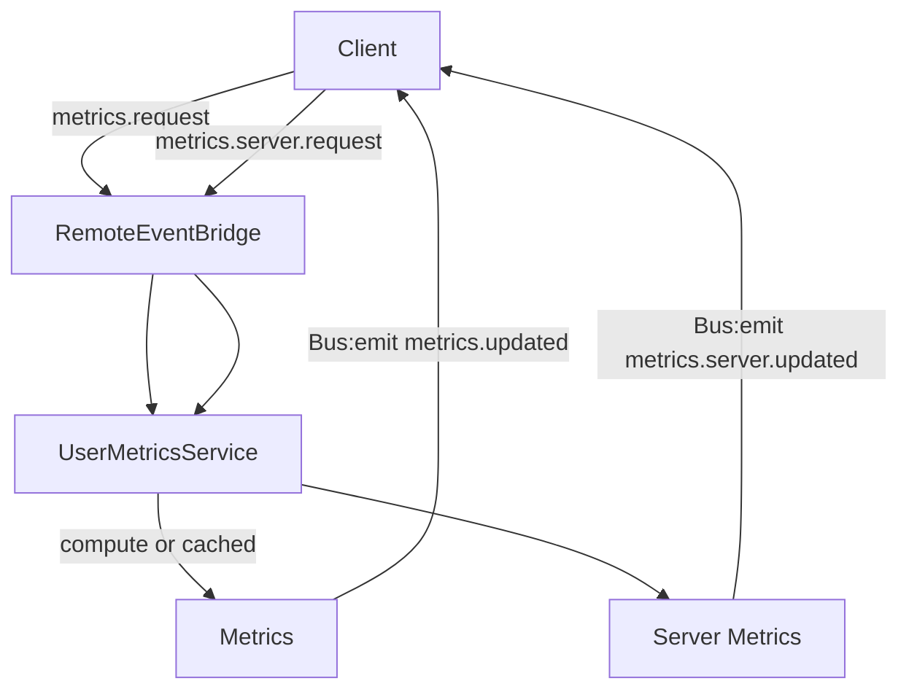

# User Metrics System

## Overview

The metrics system collects player and server insights (gameplay, economy, session, progression) and exposes them to clients via EventBus push events. Metrics are cached for a short TTL and invalidated by gameplay actions.

## Components

Server
- `server/MiningGame/UserMetricsService.lua` – Aggregation + caching
- `server/MiningGame/init.server.lua` – EventBus configuration and middleware
- `server/MiningGame/EventMetrics.lua` – Lightweight EventBus event counters

Client
- `client/MiningGame/UI/Components/MetricsTab.lua` – Debug UI for metrics (Studio)

Shared
- `shared/MiningGame/RequestNames.lua` – `metrics.request`, `metrics.server.request`
- `shared/MiningGame/EventNames.lua` – `metrics.updated`, `metrics.server.updated`

## Data Flow



Notes
- `metrics.server.updated` is visible in Studio; live servers return `{ visible = false }`.
- EventBus middleware records per-event counts; included in server metrics.

## API (Server)

```lua
-- User metrics (cached; invalidated on gameplay changes)
local m = UserMetricsService:GetMetrics(player)

-- Server-wide metrics (aggregate snapshot)
local s = UserMetricsService:GetServerMetrics()

-- Invalidate caches
UserMetricsService:Invalidate(player)
UserMetricsService:Invalidate() -- all
```

## API (Client)

```lua
-- Request metrics (server will push metrics.updated)
local Bridge = require(MiningGame.RemoteEventBridge)
Bridge.requestMetrics()

-- Subscribe to updates
local Bus = require(MiningGame.EventBus).global()
local EventNames = require(MiningGame.EventNames)
local off = Bus:on(EventNames.METRICS_UPDATED, function(m) print(m) end)

-- Server snapshot (Studio only)
Bridge.requestServerMetrics()
Bus:on(EventNames.SERVER_METRICS_UPDATED, function(s) print(s) end)
```

## Implementation Details

- Cache TTL: short (e.g., 5 seconds) to balance freshness and cost
- Invalidation: dig actions, currency changes, and other gameplay updates
- Counters: EventBus middleware increments an in-memory counter per event name

